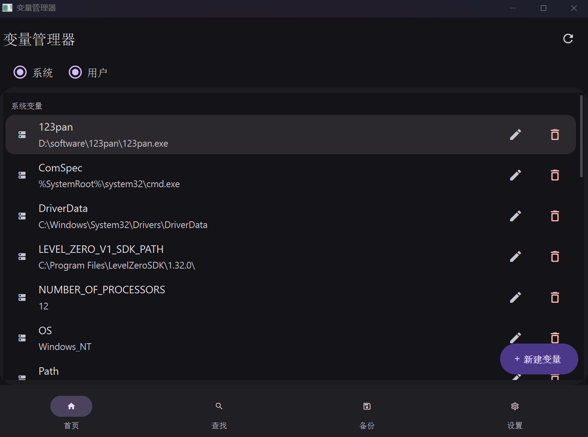
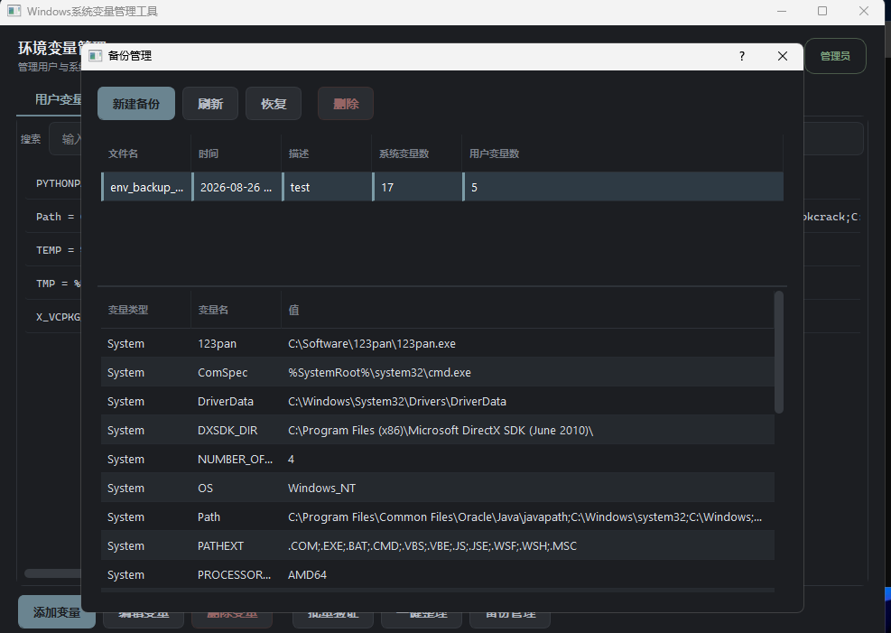

# 环境变量管理工具 V2.0

一个功能强大的 Windows 环境变量管理工具，Material 3 Expressive 深色界面，支持用户变量和系统变量的增删改查、多路径变量的表格化编辑、备份与部分恢复。

## 功能特性

### 1. 变量管理
- **添加 / 编辑 / 删除**：支持用户变量和系统变量，保存后写入注册表并广播变更，新进程和系统编辑器立即可见
- **写回校验**：每次保存自动读回注册表校验，确保真实生效
- **类型保留**：编辑时保留 REG_SZ / REG_EXPAND_SZ 类型；新建变量含 `%` 时自动识别为可扩展类型
- **管理员标识**：以管理员身份运行时标题栏显示"（管理员）"

### 2. 多路径变量（PATH）编辑
- **表格化编辑**：将分号分隔的多路径变量拆分为表格逐条编辑
- **条目快捷操作**：单击条目直接在资源管理器中打开对应文件夹（不存在时提示）；支持单条编辑与删除
- **路径有效性检查**：无效路径标红提示
- **路径浏览**：通过对话框选择文件夹路径

### 3. 备份管理
- **自动备份**：变量应用成功后自动备份（60 秒节流 + 内容去重，最多保留 5 份，列表带"自动"标签）
- **手动备份**：支持自定义描述创建备份，数量不限
- **部分恢复**：应用备份时可选恢复部分变量（按系统 / 用户分组勾选，实时计数）
- **备份删除**：删除前二次确认，支持一键撤销
- **备份瘦身**：紧凑 JSON 存储 + 内容哈希去重 + 自动备份数量上限

### 4. 搜索
- **模糊匹配**：支持前缀、子串、子序列匹配（如输入 `jh` 可命中 `JAVA_HOME`），名称命中优先于值命中

### 5. 界面体验
- **Material 3 Expressive 深色主题**：M3 角色配色 + 动态配色控件
- **三阶贝塞尔转场**：页面切换采用 emphasized 缓动曲线，顺滑流畅
- **弹窗背景模糊**：编辑、恢复等对话框打开时主界面自动毛玻璃虚化
- **Material 图标**：圆角填充 + 描边双风格图标字体

## 软件截图

### 主界面


### 备份页面


## 技术逻辑

### 架构设计
- **入口**：`main.py` - 程序启动与全局样式
- **core/** - 数据层（与 UI 解耦）：
  - `registry.py` - Windows 注册表读写、变量增删改查
  - `path_values.py` - PATH 多值解析 / 校验 / 合并
  - `backup_store.py` - 备份存储、自动备份节流与去重
  - `settings_store.py` - 应用设置与目录管理
- **ui/** - 界面层：
  - `app.py` - 主窗口、四个页面（首页 / 查找 / 备份 / 设置）、转场动画
  - `widgets.py` - 自绘 Material 控件（涟漪行、开关、对话框、PATH 表格编辑器等）
  - `theme.py` - M3 配色、全局 QSS、图标字体
  - `assets/` - Material Icons 字体与码点表

### 核心功能实现

#### 环境变量操作
- 使用 Windows 注册表 API（64 位视图）读取和修改环境变量
- 应用成功后广播 `WM_SETTINGCHANGE`，资源管理器即时刷新
- 系统变量操作检测管理员权限，无权限时引导提权

#### 备份机制
- JSON 格式存储，文件名包含来源与时间戳
- 自动备份：应用成功后触发，60 秒节流窗口 + 内容哈希去重，仅保留最新 5 份
- 恢复前强制生成 pre_restore 快照（不受节流限制），支持回退

#### 权限管理
- 检测系统变量操作权限
- 无管理员权限时系统变量行禁用并提示

## 安装和运行

### 环境要求
- Windows 10 / 11
- Python 3.10+
- PySide6

### 安装依赖
```bash
pip install -r requirements.txt
```

### 运行程序
```bash
python main.py
```

## 作者信息

作者：cc-Infiltration

## 注意事项

1. 编辑系统变量需要管理员权限
2. 请谨慎操作环境变量，不当修改可能导致系统异常
3. 建议在进行重要操作前创建手动备份

## 更新日志

### v2.0
- 界面全面重写：Material 3 Expressive 深色主题，四屏导航 + 三阶贝塞尔转场
- PATH 变量表格化编辑，条目点击打开所在文件夹
- 备份体系重构：部分恢复、自动备份节流去重、手动备份、删除撤销
- 搜索支持模糊匹配
- 架构分层：core 数据层与 ui 界面层解耦
- 弹窗背景模糊、写回校验等体验优化

### v1.0.6
- 优化了界面布局和交互体验
- 解决了备份问题
- 优化备份管理功能
